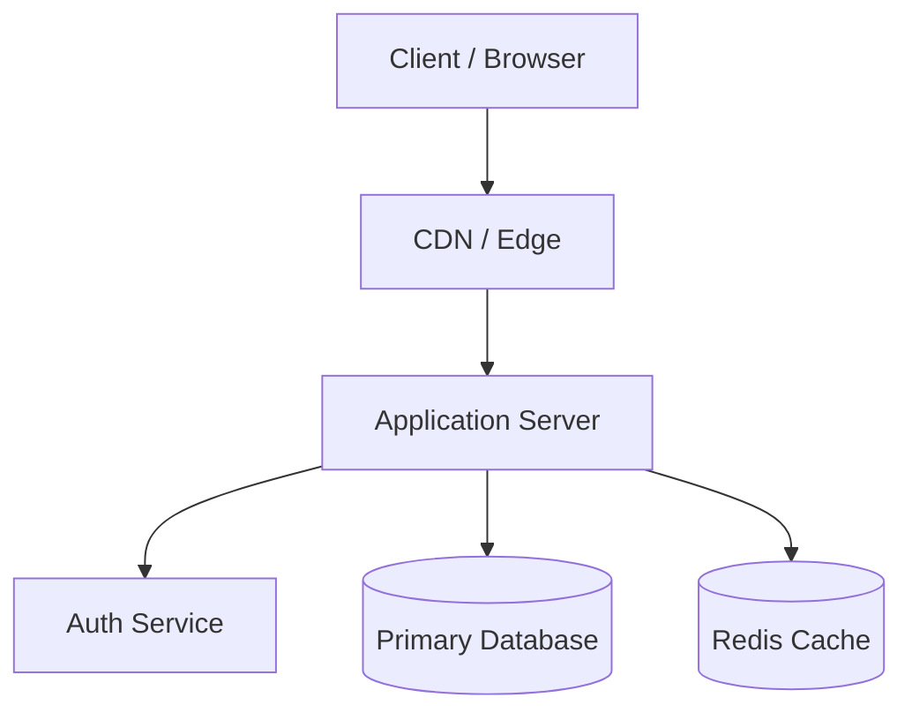

# Architecture Documentation Template (ADR & System Design)

## 1. Overview & Context
- **System Name:** 
- **Business Purpose:** 
- **Target Audience:** 

## 2. Architectural Decisions & Tech Stack
- **Frontend:** 
- **Backend / API:** 
- **Database & Storage:** 
- **Authentication & Authorization:** 
- **Cloud Infrastructure & Hosting:** 

## 3. High-Level Architecture Diagram

## 4. Key Data Models & Entity Relationships
- **Core Entities:**
- **Tenancy Model:**
- **State Machine / Lifecycles:**

## 5. Security & Compliance Controls
- In-transit and at-rest encryption standards.
- RBAC role matrices.
- Backup, recovery, and RTO/RPO targets.
